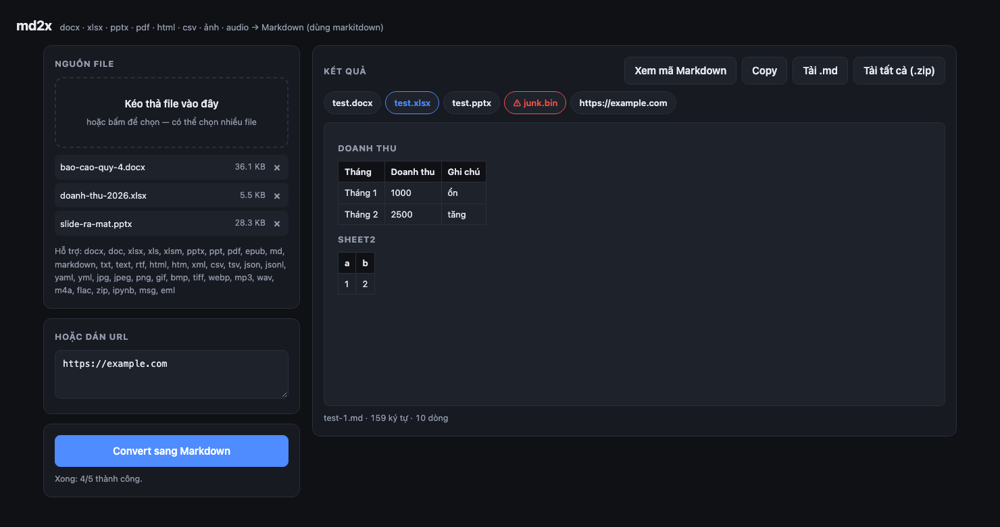

# md2x — Convert tài liệu sang Markdown

Web tool nhẹ + CLI, chạy hoàn toàn trên máy. Engine là
[markitdown](https://github.com/microsoft/markitdown) của Microsoft.



## Chạy

```bash
./run.sh                 # mở web UI tại http://127.0.0.1:8765
./run.sh serve --port 9000 --no-open
```

Lần đầu chạy, `uv` tự tải Python 3.12 + phụ thuộc (không đụng tới Python hệ thống).
Chưa có `uv`? Cài một dòng:

```bash
curl -LsSf https://astral.sh/uv/install.sh | sh
```

Không cài được uv (ví dụ Android/Termux — script cài tải binary glibc, không
chạy trên bionic)? `run.sh` vẫn chạy được với venv do pip tạo:

```bash
python3 -m venv .venv && .venv/bin/pip install -e .
./run.sh
```

Chi tiết cho điện thoại Android đã root: [deploy/android/README.md](<deploy/android/README.md>).

## CLI

```bash
./run.sh convert bao-cao.docx                 # in Markdown ra màn hình
./run.sh convert *.docx *.xlsx -o out/        # convert hàng loạt vào thư mục out/
./run.sh convert https://example.com/a.pdf    # convert từ URL
```

| Cờ | Ý nghĩa |
| --- | --- |
| `-o, --output DIR` | Lưu thành `.md` trong thư mục (bỏ qua = in ra stdout) |
| `-q, --quiet` | Chỉ in lỗi |

## Tính năng web UI

- Kéo thả **nhiều file** cùng lúc, convert song song
- Dán **URL** (trang web, PDF online, video YouTube → transcript), mỗi dòng một URL
- Xem mã Markdown hoặc bản render
- Copy, tải từng file `.md`, hoặc **tải tất cả thành `.zip`**
- Phím tắt: `Cmd/Ctrl + Enter` để convert

## Định dạng hỗ trợ

docx, doc, xlsx, xls, xlsm, pptx, ppt, pdf, epub, html, xml, csv, tsv, json,
yaml, txt, md, rtf, ipynb, msg, eml, zip, ảnh (jpg/png/gif/bmp/tiff/webp — đọc
metadata + OCR nếu có), audio (mp3/wav/m4a/flac — transcript).

## Deploy lên server

```bash
docker compose up -d --build          # hoặc dùng systemd, xem deploy/README.md
```

Android đã root: không cài được uv/wheel glibc trực tiếp, chạy trong Ubuntu qua
`proot-distro` — xem [deploy/android/README.md](<deploy/android/README.md>).

Nginx config có sẵn trong [deploy/nginx/](<deploy/nginx/>) — ba bản: domain
riêng có HTTPS, bản có mật khẩu, và bản gắn dưới subpath `/md2x/`.
Hướng dẫn đầy đủ: [deploy/README.md](<deploy/README.md>).

Nhớ để `client_max_body_size` trong nginx khớp với `MD2X_MAX_FILE_MB` của app,
không thì upload file lớn sẽ dính lỗi 413.

## Cấu trúc

```
src/md2x/
  core.py          # bọc markitdown: convert_bytes / convert_path / convert_url
  server.py        # FastAPI: GET / , /healthz , /api/info , POST /api/convert , /api/zip
  cli.py           # lệnh serve và convert
  web/index.html   # toàn bộ UI trong một file, không build, không CDN
deploy/
  nginx/           # 3 file conf: domain riêng, có mật khẩu, subpath
  systemd/         # unit file chạy nền
  README.md        # hướng dẫn deploy
Dockerfile, docker-compose.yml
samples/           # file mẫu để thử
```

## API

```bash
# Convert file và/hoặc URL
curl -X POST http://127.0.0.1:8765/api/convert \
  -F "files=@bao-cao.docx" -F "files=@so-lieu.xlsx" \
  -F "urls=https://example.com"

# Đóng gói kết quả thành zip
curl -X POST http://127.0.0.1:8765/api/zip \
  -H "Content-Type: application/json" \
  -d '{"items":[{"filename":"a.md","markdown":"# Xin chào"}]}' -o out.zip
```

Phản hồi `/api/convert`:

```json
{"results": [
  {"source": "bao-cao.docx", "ok": true, "markdown": "...", "title": null,
   "error": null, "filename": "bao-cao.md", "chars": 1532, "meta": {...}}
]}
```

Giới hạn mặc định: 200 MB mỗi file, 50 mục mỗi request. Đổi bằng biến môi trường:

```bash
MD2X_MAX_FILE_MB=500 MD2X_MAX_FILES=100 ./run.sh
```

## Ghi chú

- Server chỉ lắng nghe `127.0.0.1`; muốn chia sẻ trong LAN thì `--host 0.0.0.0`
  (không có xác thực, cân nhắc trước khi mở).
- File được xử lý trong bộ nhớ, không ghi ra đĩa.
- Chất lượng PDF phụ thuộc pdfminer: PDF scan ảnh sẽ ra rỗng (cần OCR riêng).
